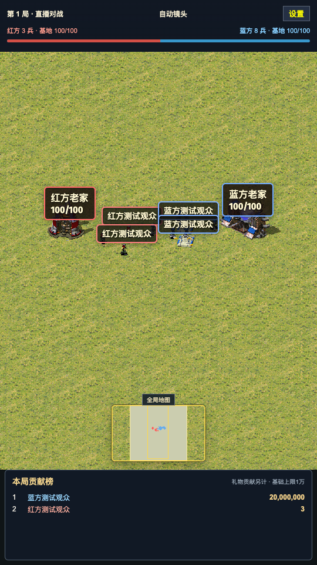
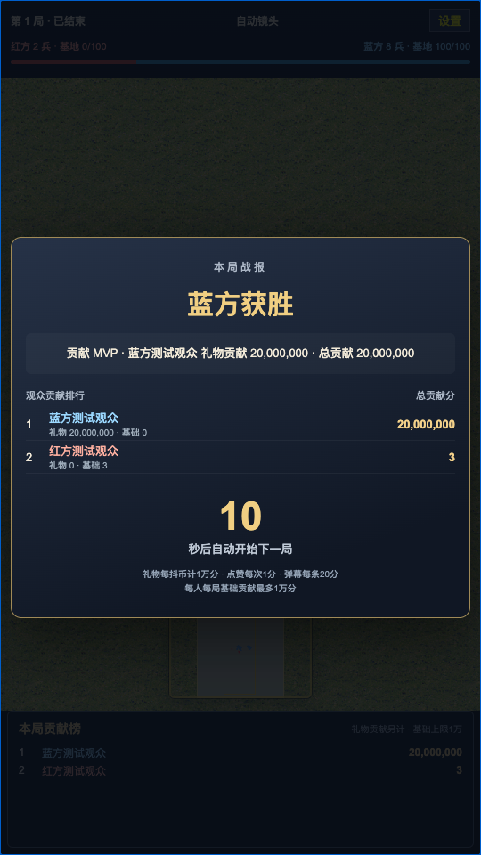

# 抖音直播红警互动游戏

面向直播互动的红警游戏原型，基于 [huangkaoya/ts-redalert2](https://github.com/huangkaoya/ts-redalert2) 开发。当前提供本地模拟事件、9:16 竖屏左右战场、随兵力分布移动的镜头、全局小地图、每局个人贡献榜，以及 10 秒结算后自动重开。

**当前状态：尚未接入真实抖音数据；Windows 实机和长时间高兵力压力测试未做。**

目前的浏览器演示和自动化验证均使用模拟弹幕、点赞、礼物，不能视为真实直播接入已完成。Windows 启动脚本已提供，仍需在 Windows 机器上实际验收。

## 启动本地模拟版

安装 Bun 1.3 及以上，在项目目录运行：

```bash
bun install --frozen-lockfile
bun run live:start
```

访问 `http://127.0.0.1:4189/#/liveinteraction`，点击顶部“设置”使用模拟事件按钮。Windows 可使用项目根目录的 `start-live.bat`。

首次启动会准备资源并构建前端。下载缓存、生成的游戏素材、构建产物和本机测试报告不包含在 Git 提交中。资源来源及准备过程见下文“本地直播模拟开发”。

## 已实现与待完成

- 已实现：竖屏左右对战、自动进攻、全局小地图和随兵力分布平滑移动的镜头。
- 已实现：按观众 ID 记录每局贡献，基础贡献上限 1 万分，礼物贡献另计；同分时礼物贡献优先。
- 已实现：胜负结算、贡献 MVP、10 秒倒计时、榜单冻结和新局清零。
- 本机已验证：类型检查、生产构建、174 个测试及浏览器模拟对局流程。
- 待完成：真实抖音数据接入、Windows 实机验收、长时间高兵力压力测试。

## 开发者从这里开始

初次参与请先读开发指南，再按事件协议与开发路线选择任务。以下文档描述当前实现，不代表待开发功能已经完成。

| 文档 | 内容 |
| --- | --- |
| [开发指南](docs/DEVELOPMENT.md) | 项目边界、架构、关键代码、启动、测试、资源准备和故障排查 |
| [事件协议](docs/EVENT_PROTOCOL.md) | 当前 HTTP/SSE 接口、字段单位、模拟示例，以及待实现的抖音映射 |
| [开发路线与验收](docs/ROADMAP.md) | 已确认需求、初版参数、待开发任务、优先级与验收条件 |
| [参与贡献](CONTRIBUTING.md) | 分支、改动范围、提交前检查和交接要求 |

当前界面如下，均使用本地模拟数据，不能视为真实抖音接入证明。

 

## 上游与参考项目

主工程保留上游 `ts-redalert2` 的 Git 历史、GPL-3.0 许可证及原有说明，开发起点为提交 `823c6637bab9ca1edafaa022a1040ed1fc59c274`。

[ape-byte/DouyinBarrageGrab](https://github.com/ape-byte/DouyinBarrageGrab) 用作后续抖音采集接入参考，[KeJunMao/open-block-war](https://github.com/KeJunMao/open-block-war) 用作个人积分、排序和结算流程参考。它们目前不是本仓库的运行依赖，真实采集适配尚未实现。

以下保留上游项目的来源、使用及许可证说明。游戏美术素材的授权范围与代码许可证需分别核对。

## RA2WEB React 上游说明

免责声明：这是基于《红色井界》RA2WEB www.ra2web.com 的分析而开发，并意图基于最新的react和three版本进行重构。但请注意，本项目与运行在 www.ra2web.com 站点上的版本无关。

隆重感谢 Chronodivide 及其创始人，这是整个网页红警创意的来源。需要额外声明：Chronodivide 不是开源项目，本项目与其无关, 也未获其认可，本项目产生的BUG和功能不完善均不得引申为 Chronodivide 项目的不完善。参与本项目的开源社区成员 igofreely 宣称希望对齐 Chronodivide 官方版本（chronodivide.com），实现录像的兼容，并且提交了若干PR，尚不清楚这些代码是否涉及对 Chronodivide 项目的侵权，换言之您使用本项目亦有可能构成对 Chronodivide 项目的侵权，请谨慎。

本项目原则上不涉及对《红色警戒2》官方分发版本的逆向、反编译或者代码抄袭，亦坚决拒绝直接声称使用AI工具对《红色警戒2》项目进行逆向、反编译转录而生成的代码合入，仅在部分介绍文字使用了“红警”“红色警戒”或者“命令与征服”的字样作为介绍使用，如您是“红警”“红色警戒”或者“命令与征服”的版权相关方，认为不妥，可以随时联系我们删除。

本项目的 VXL 渲染借鉴了 OpenRA。MIX 加解密使用了 XCC 的 `mix_decode.cpp`（Olaf van der Spek，GPL-3.0 或更高版本）。按这些许可证的要求，本项目必须采用 GPL-3.0 或更严格的许可证，因此本项目使用 GPL-3.0。

红色警戒2网页版，一款经典的即时战略类游戏的完整TypeScript重构版本，使用React + TypeScript + Vite + Three.js构建。


Disclaimer

This project is developed based on analysis of RA2WEB([www.ra2web.com](https://www.ra2web.com)), with the intention of refactoring it using the latest versions of React and Three.js. Please note that this project is independent of the build hosted at [www.ra2web.com](https://www.ra2web.com).

Special thanks to Chronodivide and its creator, the origin of the web-based Red Alert concept. Additional notice: Chronodivide is not an open-source project. This project is not affiliated with, nor endorsed by Chronodivide. Any bugs or incomplete features present in this project shall not be attributed to deficiencies in the Chronodivide project. igofreely, an open-source community contributor to this project, has stated an intent to align with the official Chronodivide build ([chronodivide.com](https://chronodivide.com)) for replay compatibility and has submitted several pull requests. It remains unclear whether such code infringes upon the rights of the Chronodivide project. In other words, your use of this project may constitute infringement against Chronodivide; proceed with caution.

In principle, this project does not involve reverse engineering, decompilation, or code plagiarism of the official distributed release of *Command & Conquer: Red Alert 2*. We firmly reject merging code generated by claiming AI tools were used to reverse-engineer or transcribe decompiled assets from *Red Alert 2*. The terms "Red Alert", "Command & Conquer" are only used in descriptive text for introductory purposes. If you are a rights holder for "Red Alert" or "Command & Conquer" and object to such usage, you may contact us at any time to request removal.

VXL rendering in this project draws inspiration from OpenRA. MIX encryption and decryption is implemented based on `mix_decode.cpp` from XCC (Olaf van der Spek, GPL-3.0 or later). Pursuant to the requirements of these licenses, this project must be licensed under GPL-3.0 or a stricter license; accordingly, this project is released under GPL-3.0.


## 项目简介

本项目是使用Typescript编写，目标是完全对标并超越“红色警戒2/尤里的复仇”的游戏逻辑，本地自行导入红色警戒2美术素材后，就可以获得类似红警2的游玩体验。当前项目还在开发中，并且已经支持完整遭遇战游玩、录像、弹幕红警对战等能力。

This project is written in TypeScript. Its goal is to fully match and surpass the game logic of *Command & Conquer: Red Alert 2 / Yuri's Revenge*. After you import Red Alert 2 art assets locally by yourself, you can get a gameplay experience similar to Red Alert 2. The project is still under active development, and it already supports full skirmish gameplay, replay files, and bullet-screen-style Red Alert multiplayer battles.

## 当前技术状态

### 运行时和构建

- 包管理与本地运行时：`Bun 1.3.10`
- 开发服务器：`Vite 8.0.1`
- UI：`React 19.2.4` + `react-dom 19.2.4`
- 类型系统：`TypeScript 5.9.3`
- 渲染：`three 0.183.2`
- 自动化：`Playwright 1.58.2`
- 默认开发和预览端口：`127.0.0.1:4000`

## 快速开始

### 环境要求

- `Bun 1.3+`
- 现代浏览器，推荐 Chrome / Edge
- 浏览器需要支持：
  - `WebGL`
  - `Web Audio API`
  - `File System Access API`

### 安装与启动

```bash
cd douyin-live-redalert
bun install --frozen-lockfile
bun run dev:bun
```

默认访问地址：

```text
https://127.0.0.1:4000
```

生产构建与预览：

```bash
bun run build
bun run preview
```

类型检查：

```bash
bun run typecheck:entry
```

## 自动化回归

### 本地直播模拟开发

在 Windows 安装 Bun 1.3 及以上后，可以双击项目根目录的 `start-live.bat`，或在终端运行：

```bash
bun install --frozen-lockfile
bun run live:start
```

访问 `http://127.0.0.1:4189/#/liveinteraction`。右侧的模拟点赞、礼物、弹幕按钮可以生成增援，单位会攻击敌方基地；画面采用完整的 9:16 竖屏，红方在左、蓝方在右；主镜头平滑跟随存活兵力分布，底部小地图显示全局。基地被摧毁后显示胜负、贡献 MVP 和本局贡献榜，倒计时 10 秒后自动创建新一局。结算期间收到的事件不计分、不出兵，下一局贡献清零。目前尚未启用真实直播采集。

`live:start` 会准备本地资源、构建前端并启动仅监听本机的 HTTP/SSE 服务。首次准备会下载本项目 `config.ini` 所配置来源的素材包 `https://download.ra2web.com/full-pack.7z`（约 110 MiB），提取素材并整理为 `public/cdn/game-res/v2/` 中的 18 个 MIX 文件。`manifest.json` 保存 CRC32 校验值及来源包 SHA256。游戏美术来自该上游素材包；平地双人地图及加载背景由脚本生成。素材来源与许可须按本项目现有说明核对。

生成文件和下载缓存不纳入 Git。缓存位于 `.artifacts/source/`，已有缓存时无需重复下载。资源包、缓存及构建目录需要约 1 GiB 的可用空间。也可以单独运行 `bun run assets:prepare`，或用 `bun run assets:prepare "本地素材包.7z"` 指定包含 `RA2.MIX`、`LANGUAGE.MIX` 的素材包。

开发时在两个终端分别运行 `bun run live:runtime` 和 `bun run dev:bun`，访问 Vite 输出的 HTTPS 地址（默认端口 4000）。Vite 会将直播 API 转发到本机 4189 端口。

```bash
bun run typecheck:entry
bun test
bun run build
bun run debug:live-interaction
```

贡献规则集中在 `src/game/live/ContributionLedger.ts`：点赞每次 1 分、弹幕每条 20 分，每位观众每局的非礼物基础贡献合计最多 10000 分；礼物按本次总抖币数每抖币 10000 分另计，不受基础贡献上限限制。排行按总贡献降序，同分时礼物贡献优先。观众身份使用字符串 ID，同名观众分开统计；首次参与后的阵营在本局保持一致。上述礼物倍率为当前初版参数。

直播模块已纳入主入口类型检查和生产构建。端到端脚本使用本机 Chrome 或 Playwright Chromium，实际验证模拟出兵、自动战斗、基地摧毁、10 秒结算看板、贡献榜冻结、自动重开、积分清零，以及 540 像素和 390 像素竖屏无横向裁切。缺少浏览器时运行 `bunx playwright install chromium`，或用 `CHROME_PATH` 指定 Chrome 程序路径。测试报告和截图保存在 `.artifacts/live-interaction/`。

下方回归命令列表保留自上游，其中多数 `scripts/` 文件未随本仓库提交。当前可用的脚本及检查命令以[开发指南](docs/DEVELOPMENT.md)为准；直播端到端验证使用 `bun run debug:live-interaction`。

常用命令包括：

```bash
bun run debug:game-res-init
bun run debug:viewport
bun run debug:options
bun run debug:storage-explorer
bun run debug:skirmish
bun run debug:skirmish-lobby-data
bun run debug:victory-exit
bun run debug:superweapon
bun run debug:nuke
bun run debug:radiation
bun run debug:minimap-shroud
bun run debug:anti-air-hit
bun run debug:terror-drone
bun run debug:chrono-legionnaire
bun run debug:test-entries
bun run debug:tester-panels
```

这些脚本的产物默认会写入 `.artifacts/`，便于回看截图和 JSON 结果。

## 测试入口

主菜单中的测试入口目前分为三类：

1. 素材测试
   - `VXL测试`
   - `SHP测试`
   - `音频测试`
2. 机制测试
   - `建筑测试`
   - `载具测试`
   - `步兵测试`
   - `飞行器测试`
3. 场景测试
   - `大厅测试`
   - `世界测试`
   - `移动测试`

这些 tester 页面不是孤立 Demo，而是当前仓库里很重要的调试和回归入口。页面左侧面板状态会同步到调试状态对象，自动化脚本也会直接使用这些入口验证渲染和交互结果。

## 技术架构

### 核心技术栈

- `React 19.2.4`
- `TypeScript 5.9.3`
- `Vite 8.0.1`
- `three 0.183.2`
- `Bun 1.3.10`
- `Playwright 1.58.2`
- `7z-wasm`
- `file-system-access`
- `@ffmpeg/ffmpeg`
- `@ra2web/pcxfile`
- `@ra2web/wavefile`

### 目录说明

```text
redalert2/
├── public/          静态资源、配置、locale、遗留样式
├── scripts/         Playwright 自动化回归脚本
├── src/
│   ├── data/        原版资源格式、编码、地图、VFS
│   ├── engine/      渲染、音频、资源加载、底层引擎能力
│   ├── game/        游戏逻辑、对象系统、触发器、规则、超武
│   ├── gui/         主菜单、HUD、选项、游戏内 UI
│   ├── network/     网络和联机相关基础设施
│   ├── tools/       独立 tester 页面
│   └── util/        通用工具
├── docs/            对齐记录与工程说明
└── vite.config.ts   开发和构建配置
```

### 主要模块

`src/engine/`

- `gfx/`：three 渲染层、材质、批处理、viewport、lighting
- `renderable/`：游戏对象到可视对象的桥接层
- `sound/`：音频混音、音乐、音效播放
- `gameRes/`：资源导入、CDN 加载、缓存与目录处理

`src/game/`

- `gameobject/`：单位、建筑、抛射体、trait、locomotor
- `rules/`：INI 规则读取与对象规则构建
- `trigger/`：地图触发器、条件、执行器
- `superweapon/`：核弹、闪电风暴、超时空等超武逻辑

`src/gui/`

- `screen/mainMenu/`：主菜单、地图选择、大厅、选项
- `screen/game/`：游戏内 HUD、世界交互、菜单
- `component/`：React 组件
- `jsx/`：自定义 UI 渲染桥接

`src/tools/`

- 提供素材、机制、场景三类 tester 页面
- 当前是调试结果可视化和自动化断言的重要入口

## 开发命令

```bash
bun run dev
bun run build
bun run preview
bun run typecheck:entry
```

## 文档与调试约定

- 开发端口固定为 `4000`
- 主要技术对齐记录维护在 `docs/build-alignment-log.md`
- 自动化产物默认输出到 `.artifacts/`
- 构建通过并不等于所有行为已完全对齐，功能层面仍应优先参考专项脚本和实际流程验证

## 贡献建议

提交改动前，至少建议执行：

```bash
bun run typecheck:entry
bun run build
```

如果改动涉及大厅、资源加载、进图、HUD、机制或 tester，请补跑相应的 `debug:*` 脚本。

## 许可证

本项目基于GNU General Public License v3.0（GPL-3.0）许可证开源。详见 [LICENSE](LICENSE) 文件。

### 重要说明
- 可以自由使用、修改和分发，但禁止商用
- 必须保留版权声明和许可证文本
- 任何衍生作品必须使用相同的 GPL-3.0 许可证
- 必须提供源代码，包括修改后的版本
- 不能将 GPL 代码集成到专有软件中

**注意：** 本项目仅用于学习和研究目的，只维护引擎部分。红色警戒2游戏副本是EA公司的知识产权，导入美术素材时请确保拥有合法的游戏副本。

**NOTE:** This project is for educational and research purposes only, and only maintains the engine component. Copies of *Command & Conquer: Red Alert 2* are intellectual property of Electronic Arts (EA). Please ensure you own a legitimate copy of the game before importing its art assets.

## 致谢 Special Thanks

- Chronodivide
- 《红色井界》RA2WEB.COM
- Three.js 社区
- React 团队
- TypeScript 团队
- 相关开源依赖维护者
- 红警2/命令与征服/心灵终结/尤里的复仇 玩家社区

---

本项目仅供学习研究使用，不用于商业目的。

---
