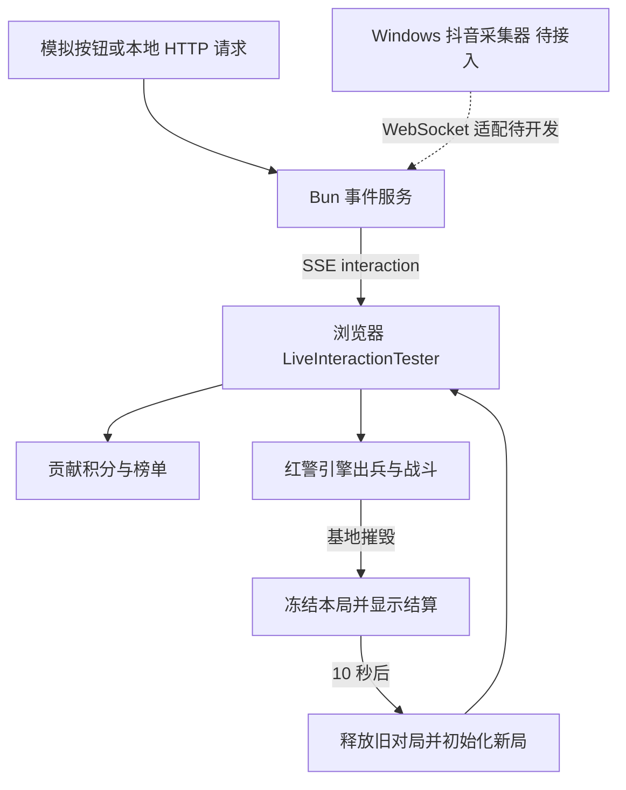

# 开发指南

这是直播互动游戏原型的接手入口。目标正式环境为 Windows，同机运行游戏和后续弹幕采集器。当前仓库可以独立运行本地模拟版，其他两个参考仓库不是启动依赖。

**尚未接入真实抖音数据；Windows 实机和长时间高兵力压力测试未做。**

## 当前交接基线

基线为提交 `27630e199c93766634f6d81360bcf30baecefc71`，记录日期为 2026 年 11 月 8 日。已在 macOS、Bun 1.3.14 和本机 Chrome 上验证类型检查、生产构建、174 个测试及浏览器模拟对局。测试数量是这次基线的记录，后续以实际运行结果为准。

已实现 9:16 竖屏、左右出生点、原生战斗和自动进攻、按兵力分布移动的镜头、全局小地图、个人贡献榜、胜方贡献 MVP、10 秒结算和新局清零。贡献积分来自互动事件，与引擎按击杀计算的 `Player.score` 是两套数据；当前贡献分不作为可消费的出兵余额。

本版本没有持久化排行榜、历史对局数据库或服务端权威模拟。刷新游戏页面会重新建立浏览器内的对局；多开标签页会各自模拟游戏，不能当作多个客户端共享同一局。

## 三个项目的关系

| 项目 | 在这里的职责 |
| --- | --- |
| [huangkaoya/ts-redalert2](https://github.com/huangkaoya/ts-redalert2) | 本仓库的上游，提供游戏引擎、素材加载、渲染与互动战场基础 |
| [ape-byte/DouyinBarrageGrab](https://github.com/ape-byte/DouyinBarrageGrab) | 后续采集参考，Windows C# 工程，通过 WebSocket 推送消息；当前未接入 |
| [KeJunMao/open-block-war](https://github.com/KeJunMao/open-block-war) | 个人积分、排序和对局结算的思路参考，无需同时运行 |

本仓库保留上游 Git 历史及许可证。优先在现有主工程内接线，不把三个项目的 UI、状态库和游戏循环直接拼成同一个应用。

## 运行架构



事件服务负责 HTTP、输入校验、SSE 和静态文件；当前不计算战斗结果，也不保存贡献榜。浏览器负责阵营记录、出兵、游戏模拟、贡献积分、镜头和结算。相关协议见[事件协议](EVENT_PROTOCOL.md)。

## 环境与首次启动

| 项目 | 要求或用途 |
| --- | --- |
| Bun | 项目要求 1.3 及以上，`packageManager` 标注 1.3.10；交接基线验证版本为 1.3.14 |
| 浏览器 | 支持 WebGL 的现代浏览器，浏览器验证使用 Chrome |
| Node.js | 使用 `bun run dev` 时需要；Vite 8.0.1 声明 `^20.19.0` 或 `>=22.12.0`。使用 `dev:bun` 可直接由 Bun 执行 |
| 空间与网络 | 首次下载约 110 MiB；源包、提取缓存、生成资源及构建目录合计约需 1 GiB 空间 |

```bash
git clone https://github.com/xiehaibo11/douyin-live-redalert.git
cd douyin-live-redalert
bun install --frozen-lockfile
bun run live:start
```

打开 `http://127.0.0.1:4189/#/liveinteraction`，点击顶部“设置”，使用模拟点赞、礼物和弹幕按钮。Windows 提供 [`start-live.bat`](../start-live.bat)，它执行安装依赖和同样的启动流程，但仍待 Windows 实机验收。

`live:start` 依次准备资源、构建前端、启动本地服务。当前模拟版运行的是浏览器与 Bun 服务，采集器的系统代理和证书流程属于后续真实数据接入工作。

## 日常开发

先准备一次资源，再开两个终端：

```bash
bun run assets:prepare
```

终端一运行 `bun run live:runtime`；终端二运行 `bun run dev:bun`。打开 `https://127.0.0.1:4000/#/liveinteraction`，以 Vite 实际打印的地址为准。当前开发配置启用 HTTPS，首次打开可能需要处理本地开发证书提示。Vite 将 `/api/live-interaction` 转发到本机 4189 端口。

| 变量 | 用途与限制 |
| --- | --- |
| `PORT` | 覆盖本地运行服务的默认 4189 端口。开发代理目标仍写在 `vite.config.ts` 中，改端口时要一起调整 |
| `CHROME_PATH` | 指定端到端验证使用的 Chrome 可执行文件；不控制用户访问页面时的浏览器 |

服务只监听 `127.0.0.1`，当前交付范围是单机模拟。不要直接作为公网或局域网多用户服务部署。

## 关键代码位置

| 文件或目录 | 阅读及修改入口 |
| --- | --- |
| [`src/Application.ts`](../src/Application.ts) | 资源初始化、`/liveinteraction` 路由和直播模块的生产构建导入 |
| [`src/tools/LiveInteractionTester.ts`](../src/tools/LiveInteractionTester.ts) | 当前直播玩法主协调器：布局、事件流、出兵、镜头、贡献展示、结算与销毁 |
| [`src/tools/live-interaction.css`](../src/tools/live-interaction.css) | 竖屏 HUD、贡献榜和结算看板样式 |
| [`ContributionLedger.ts`](../src/game/live/ContributionLedger.ts) | 纯贡献规则、观众 ID、基础上限、礼物分、排序和冻结 |
| [`LiveRound.ts`](../src/game/live/LiveRound.ts) | `loading`、`running`、`settling` 状态及 10 秒重开时间 |
| [`BroadcastCamera.ts`](../src/game/live/BroadcastCamera.ts) | 根据存活单位位置计算镜头关注点 |
| [`scripts/live-interaction-runtime.mjs`](../scripts/live-interaction-runtime.mjs) | 当前 HTTP/SSE 服务、模拟事件校验、静态资源服务 |
| [`scripts/prepare-live-assets.ts`](../scripts/prepare-live-assets.ts) | 素材提取、MIX 打包、清单、训练地图和加载背景生成 |
| [`scripts/live-interaction-flow.mjs`](../scripts/live-interaction-flow.mjs) | 浏览器对局与竖屏回归 |
| [`src/game/Game.ts`](../src/game/Game.ts) | 引擎模拟与战斗事件，修改玩法前优先寻找现有事件入口 |
| [`src/test/live/`](../src/test/live/) | 事件服务、资源、贡献规则和对局状态测试 |

`LiveInteractionTester` 的 `handleInteractionEvent` 先检查阶段、时间戳和消息 ID，再解析出兵计划、记录贡献并生成单位。`updateBattle` 检查基地状态，首次结束时冻结贡献榜；定时器到期后通过 `main` 重新初始化。`destroy` 关闭事件流、清除定时器和去重记录，并释放游戏、视图及渲染资源。

外层应用通过 `data-live-broadcast-frame` 识别直播画幅，由直播页接管尺寸；销毁时会清除此标记。修改窗口布局时保留这个交接，否则外层布局可能在缩放时覆盖画幅位置。

## 资源与地图

源码仓库不携带生成的 CDN 目录和下载源包。准备脚本默认从项目配置的上游资源地址下载，在 `.artifacts/source/` 缓存原包和提取结果。生成位置：

- `public/cdn/game-res/v2/`：18 个 MIX 文件、加载图片和 `manifest.json`。
- `public/cdn/maps/2_reconcile.map`：脚本生成的平地双人地图，左右出生点，使用游戏自身解析器校验。
- `dist/`：构建时复制的静态资源及前端产物。

`manifest.json` 的版本为 2、格式为 `mix`；MIX 加载使用 CRC32 校验，来源包通过 SHA256 标记。游戏美术来自上游素材包，训练地图与加载背景由脚本生成。资源包目前有部分条目重复，内存与加载开销仍待压测。

可运行 `bun run assets:prepare "本地素材包.7z"` 指定输入包。当前提取代码要求压缩包根目录存在名称为 `RA2.MIX`、`LANGUAGE.MIX` 的条目；不同层级或命名的包需要先调整或扩展提取逻辑。指定本地包时，SHA256 对应实际输入，但清单的来源 URL 字段目前仍使用默认值，不能把它当作完整来源证明。

## 验证和调试

```bash
bun run typecheck:entry
bun test
bun run build
bun run debug:live-interaction
```

首次缺少测试浏览器时运行 `bunx playwright install chromium`，或设置 `CHROME_PATH`。端到端脚本启动自己的临时端口，实际验证模拟出兵、基地被摧毁、10 秒结算、榜单冻结、自动重开、积分清零和两种窄屏布局。输出位于 `.artifacts/live-interaction/`，包括 `report.json`、战斗、结算和新局截图。

测试通过了模拟路径，并不等于完成真实平台验收。该脚本使用 `advanceTicks` 快速推进真实游戏模拟，不能用其运行时长或截图判断实时帧率与高兵力性能。

浏览器控制台可读取 `window.__ra2debug.liveInteraction.snapshot()`。`emitMock(kind, payload)` 经本地事件服务发送模拟事件；`advanceTicks(1..600)` 仅用于模拟模式的快速回归。调试游戏对象可查看 `window.__ra2debug.liveInteractionBattle`。

当前 `scripts/` 只提交资源准备、直播运行服务和直播端到端三个文件。其余上游 `debug:*`、部分 `sim:*` 命令可能仍列在 `package.json`，缺少脚本时不能运行；需要时再单独恢复和验收。

## 常见问题

| 现象 | 排查方式 |
| --- | --- |
| 4189 端口已占用 | 检查占用进程；选择其他端口时同步处理开发代理，不要结束不属于本项目的进程 |
| 素材 404 或无法初始化 | 确认 `assets:prepare` 成功且清单、资源和地图存在；纯运行服务启动前先构建 |
| 自带压缩包无法提取 | 检查根目录条目及名称，查看提取错误；脚本已处理 Emscripten 中的文件权限位 |
| 主入口能构建，旧 tester 却不能打开 | 部分上游 tester 仍使用可选开发导入；当前只保证已验收的直播入口 |
| Playwright 找不到浏览器 | 安装 Chromium 或设置 Chrome 路径，检查其可执行权限 |
| 看到完整战场但贡献榜为空 | 当前只有点赞、弹幕和礼物计贡献；模拟按钮只影响打开并接收事件的浏览器，服务不回放历史事件 |
| 刷新后榜单清空或多窗口不同步 | 当前状态在浏览器内存中，尚无持久化和服务端权威对局 |

后续开发优先级和可验收条件见[开发路线](ROADMAP.md)。
